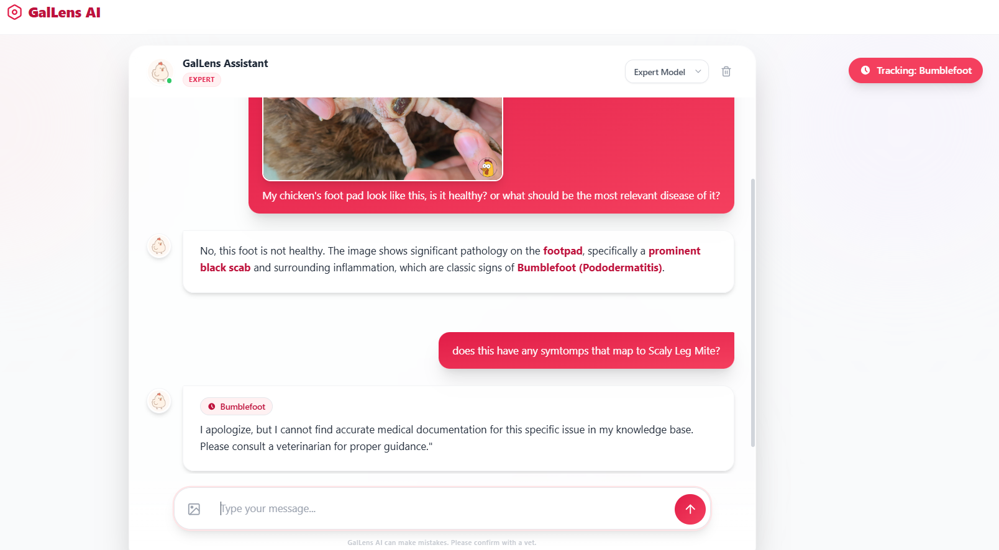
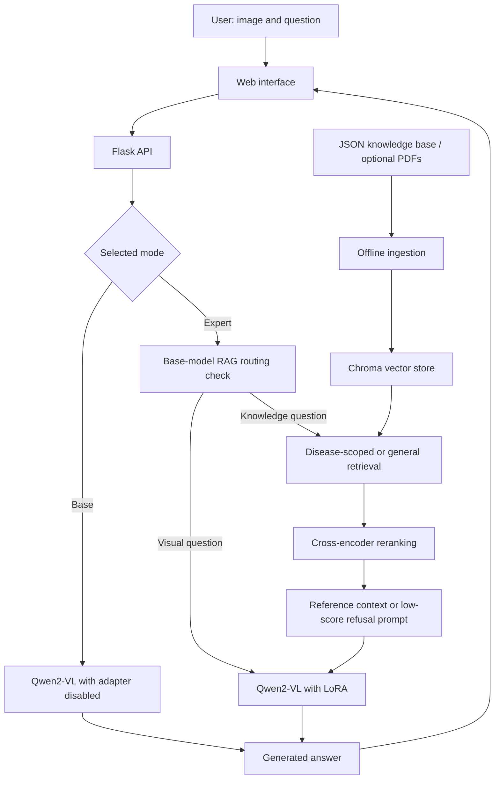
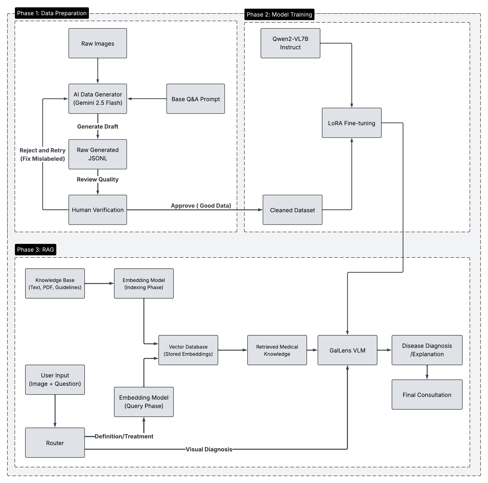

# GalLens

**Vision–language assistance for chicken health assessment and visual question answering.**

GalLens combines **Qwen2-VL-7B-Instruct**, **LoRA fine-tuning**, and **retrieval-augmented generation (RAG)** to answer questions about chicken images and retrieve supporting veterinary knowledge. Designed for non-expert poultry farmers, the project includes a web interface, a structured knowledge base, training code, and offline evaluation scripts.

**Project status:** Research prototype. Running this checkout requires local model artifacts, path configuration, compatible dependencies, and the integration adjustments described below. Generated assessments do not establish a veterinary diagnosis.

[Demo](#demo) · [Features](#key-features) · [Architecture](#architecture) · [Getting Started](#getting-started) · [Usage](#usage) · [Results](#evaluation-and-results)

## Demo



*Project demo screenshot. Review the setup requirements and known issues before running the current source.*

## Contents

- [Key Features](#key-features)
- [Architecture](#architecture)
- [Repository Structure](#repository-structure)
- [Getting Started](#getting-started)
- [Running the Application](#running-the-application)
- [Usage](#usage)
- [API Reference](#api-reference)
- [Knowledge Base and RAG](#knowledge-base-and-rag)
- [Fine-Tuning](#fine-tuning)
- [Evaluation and Results](#evaluation-and-results)
- [Limitations and Known Issues](#limitations-and-known-issues)
- [Attribution, License, and Citation](#attribution-license-and-citation)

## Key Features

- **Image-based question answering:** Ask about visible body parts, abnormalities, and possible disease indicators.
- **Visual explanations:** Generate image descriptions and explain observed signs alongside health assessments.
- **Base and Expert modes:** Compare the base model with a LoRA-adapted model through one interface.
- **Conditional knowledge retrieval:** Route selected treatment, prevention, and disease-definition questions to a veterinary knowledge base.
- **Disease context tracking:** Extract a disease name from Expert responses to scope later retrieval.
- **Offline research pipelines:** Generate and refine VQA data, train LoRA adapters, and evaluate model outputs.

The current web flow requires an image for every analysis request, including knowledge-oriented questions. Disease context is held in browser memory; full conversation history is not sent to the model.

## Architecture



### Request Lifecycle

1. The browser sends an image, question, selected model, and optional disease context to Flask.
2. In Expert mode, the base model checks whether the question needs knowledge retrieval.
3. If retrieval is selected, the RAG engine searches for relevant chunks and reranks them.
4. The backend builds a prompt and generates an answer using Qwen2-VL.
5. The browser renders the answer and, in Expert mode, requests disease-name extraction for future retrieval.

Retrieved context is not guaranteed for every answer. Empty retrieval falls back to the original question; low-scoring non-empty results trigger a refusal instruction. First-turn context handling has a known issue documented below.

### Technology Stack

| Component | Implementation |
| --- | --- |
| Web interface | HTML, vanilla JavaScript, Tailwind CSS, Marked, Feather Icons |
| Backend | Flask and Flask-CORS |
| Vision–language model | `Qwen/Qwen2-VL-7B-Instruct` |
| Fine-tuning | LoRA through PEFT and Transformers Trainer |
| Embeddings | `BAAI/bge-m3` |
| Retrieval | Chroma semantic search; optional in-process BM25 ensemble |
| Reranking | `cross-encoder/ms-marco-MiniLM-L-6-v2` |
| Data generation | Gemini through `google.generativeai` |
| Offline evaluation | Gemini, BioBERT similarity, scikit-learn |

The model and RAG engine initialize within the application process. User authentication, a separate inference service, a job queue, and server-side chat persistence are not implemented.

<details>
<summary>Original project pipeline illustration</summary>



The diagram above is an existing project asset. The request lifecycle and known issues in this README describe the current code behavior.

</details>

## Repository Structure

```text
.
├── Backend/
│   └── api.py                      # Flask routes, model loading, inference
├── templates/
│   └── index.html                  # Chat interface
├── static/                         # Client behavior and UI assets
├── rag_modules/
│   ├── config.py                   # Retrieval models, paths, and flags
│   ├── engine_v2.py                # Ingestion, retrieval, reranking, evaluation
│   ├── ingest.py                   # Knowledge indexing entry point
│   └── test_RAG_confidence.py       # Manual retrieval diagnostic script
├── Train/                          # Dataset, collator, callbacks, LoRA training
├── CustomDataset/                  # Gemini-based VQA generation and refinement
├── Dataset Sample/
│   ├── VQA/                        # Training, validation, negative-sample JSONL
│   └── images/                     # Sample images
├── KB-Final/
│   ├── KB/                         # Structured knowledge chunks
│   └── Ground-truth/               # Retrieval evaluation questions
├── Model Evaluation/               # Evaluation scripts and saved artifacts
├── Figure/                         # Demo, pipeline, and result images
└── README.MD
```

## Getting Started

### Prerequisites

- A Python environment compatible with Qwen2-VL, Transformers, PEFT, and the LangChain imports used here.
- An NVIDIA GPU and compatible CUDA/PyTorch installation for the current backend, which explicitly loads the model on `cuda:0`.
- Access to the base-model, embedding-model, and reranker weights, or their local caches.
- A trained LoRA adapter for Expert mode and adapter-dependent operations.
- For training: support for `flash_attention_2` and the configured BF16/TF32 operations.

A tested Python/CUDA version matrix, measured minimum VRAM requirement, dependency lockfile, and downloadable project adapter are not provided in this checkout.

### Installation

Run commands from the project root unless another directory is specified.

```bash
python -m venv .venv
```

Activate the environment using the command for your shell:

```powershell
# Windows PowerShell
.\.venv\Scripts\Activate.ps1
```

```bash
# Linux shell
source .venv/bin/activate
```

Install a CUDA-compatible PyTorch build for the target machine first. The following groups identify additional packages imported by the source; they are **not a version-pinned, validated installation specification**. Select mutually compatible versions, particularly for Transformers, PEFT, and LangChain.

| Task | Packages |
| --- | --- |
| Web inference | `transformers`, `peft`, `accelerate`, `flask`, `flask-cors`, `pillow` |
| Retrieval | `langchain`, `langchain-core`, `langchain-community`, `langchain-huggingface`, `chromadb`, `sentence-transformers`, `rank-bm25` |
| Optional PDF ingestion | `pypdf` |
| Training | `numpy`, `tqdm`, `flash-attn`, plus model dependencies |
| Data generation and evaluation | `google-generativeai`, `pandas`, `numpy`, `tqdm`, `scikit-learn`, `matplotlib`, `seaborn`, plus model dependencies |

### Model and Data Preparation

1. Make `Qwen/Qwen2-VL-7B-Instruct` available through Hugging Face or a local cache.
2. Provide a PEFT adapter directory containing `adapter_config.json` and adapter weights. Use the corresponding processor files when available.
3. Configure `KB-Final/` as the knowledge source for RAG and prepare a Chroma index.
4. For training or evaluation, provide the complete image corpus and matching JSONL inputs. The sample images do not cover the full included VQA corpus.

### Configuration

Paths are currently Python constants rather than a unified environment-variable configuration. Replace the original machine-specific paths before running.

| File | Settings to review |
| --- | --- |
| [Backend/api.py](Backend/api.py) | `CACHE_DIR_PATH`, `LORA_PATH`, model ID, CUDA settings, Flask resource paths |
| [rag_modules/config.py](rag_modules/config.py) | `BASE_DIR`, `DOCS_DIR`, `VECTOR_DB_DIR`, `EMBEDDING_CACHE_DIR`, `METRICS_LOG_FILE` |
| [Train/config.py](Train/config.py) | `DATA_ROOT`, `TRAIN_JSONL`, `VAL_JSONL`, `OUTPUT_DIR`, training settings |
| [Model Evaluation/](Model%20Evaluation/) | Test file, image root, adapter, input/output directories, Gemini credentials |
| [CustomDataset/](CustomDataset/) | Input/output paths and Gemini credentials |

For this layout, `DOCS_DIR` should resolve to `KB-Final/`, whose children are `KB/` and `Ground-truth/`. The current default points to an external `KB_for_RAG/` directory.

The Flask app is defined inside `Backend/`, but its templates and static assets are at the project root. Before serving the interface, replace its current `Flask(__name__)` initialization with a configuration that resolves those directories, for example:

```python
project_root = os.path.dirname(os.path.dirname(os.path.abspath(__file__)))
app = Flask(
    __name__,
    template_folder=os.path.join(project_root, "templates"),
    static_folder=os.path.join(project_root, "static"),
)
```

This is a required local setup adjustment, not a change already applied to the backend.

Gemini scripts contain empty credential placeholders. Supply credentials locally for offline data generation or evaluation and keep populated credentials out of version control. Web inference does not call Gemini.

## Running the Application

After preparing dependencies, model artifacts, the knowledge index, paths, and Flask resource configuration:

```bash
python -m Backend.api
```

Open **http://localhost:5000**. The configured server binds to `0.0.0.0:5000` with debug mode disabled.

This starts Flask's built-in server. A production server configuration, Docker image, and deployment pipeline are not supplied. The command identifies the application entry point; startup from a clean environment has not been independently reproduced during documentation review.

## Usage

1. Upload or drag a chicken image into the interface.
2. Select **Base** or **Expert**.
3. Enter a question, such as “Which part of the chicken is visible?”, “What abnormalities are visible?”, or “What disease might these signs suggest?”
4. Read the generated response. The first turn requests an image description before the answer.
5. In Expert mode, ask a knowledge question such as “How can Newcastle disease be prevented?” The router may activate RAG.
6. Use **New Chat** when changing cases to reset the browser session and disease context.

The browser renders generated Markdown and tracks an extracted disease name for later retrieval. It does not send the complete chat history to the model, and the API does not return retrieved sources or retrieval scores to the interface.

## API Reference

### `POST /api/analyze`

Accepts JSON with a base64 image or image data URL:

```json
{
  "image": "data:image/jpeg;base64,<encoded-image>",
  "question": "What abnormalities are visible?",
  "model_type": "finetuned",
  "is_first_turn": true,
  "disease_context": null
}
```

| Field | Purpose |
| --- | --- |
| `image` | Required image payload |
| `question` | Required non-empty question |
| `model_type` | `finetuned` for Expert or `base` for Base; defaults to `finetuned` |
| `is_first_turn` | Requests an initial description; defaults to `false` |
| `disease_context` | Optional disease name used to scope retrieval |

Successful response shape:

```json
{
  "success": true,
  "answer": "<generated response>",
  "model_used": "finetuned"
}
```

Failures return `success: false` and an `error` message with HTTP 400 or 500, depending on the failure path.

### `POST /api/extract_disease`

Accepts `{"response_text": "<model answer>"}`. The base model extracts a disease name, which is matched against a predefined list. Successful responses contain `success`, `disease` (a matched name or `null`), and `raw_extraction`.

Implementation: [Backend/api.py](Backend/api.py).

## Knowledge Base and RAG

### Included Knowledge

The included KB contains **486 chunks across 11 JSON files**, with **182 retrieval evaluation questions across 11 ground-truth JSON files**. Subjects include avian influenza, Newcastle disease, chronic respiratory disease, Salmonella, coccidiosis, foot conditions, and healthy appearance.

Knowledge items follow this structure:

```json
{
  "id": "unique_chunk_id",
  "content": "Reference text",
  "vector_context": {
    "hypothetical_questions": ["A related question"],
    "keywords": ["topic"]
  },
  "metadata": {
    "disease": "disease_tag",
    "sources": ["<reference URL>"]
  }
}
```

Ingestion augments the embedding text with hypothetical questions and preserves original content for answer context. Reference URLs are stored in metadata but are not returned as answer-level citations. The loader supports optional PDFs; the supplied ground-truth files are JSON, and PDF source documents are not included.

### Build the Index

After configuring the knowledge and database paths:

```bash
python -m rag_modules.ingest
```

**This rebuilds the Chroma collection and replaces its previous contents.** Use a dedicated index directory.

### Retrieval Behavior

- Expert-mode routing considers treatment, prevention, and disease-definition questions.
- Retrieval optionally filters by the supplied disease name, with a general-search fallback.
- The configured candidate count is 10; the web API requests 3 final chunks.
- The reliability threshold is **0.3 on the reranker's raw score**, not a probability or percentage.
- Low-scoring non-empty results trigger a refusal instruction; empty results fall back to the original question.

The web API uses `search_with_confidence()`. Query expansion, caching, deduplication, and retrieval metrics in the separate `search()` method do not automatically apply to that path. BM25 initializes during ingestion and is not restored when a new process opens the persisted Chroma database. If the reranker is unavailable, the confidence path leaves the score at zero.

## Fine-Tuning

The training pipeline applies LoRA to Qwen2-VL attention and MLP projection layers. It masks the user prompt from the loss and trains on assistant answers.

### Dataset Format

```json
{"img_path": "images/example.jpg", "question": "What is visible?", "answer": "A reference answer."}
```

The loader accepts `img_path` or `image`, then finds an image by its basename under `DATA_ROOT`. Filenames should therefore be unique across the image corpus.

| Included data | Count |
| --- | ---: |
| Main training JSONL | 93,805 rows |
| Main validation JSONL | 10,423 rows |
| Additional negative-sample JSONL files | 297 rows across 3 files |
| Sample images | 63 files |

Row counts do not establish unique image counts, complete image coverage, or verified train/validation separation. Negative-sample files are not automatically merged by the training entry point.

### Default Training Settings

| Setting | Value |
| --- | --- |
| Base model | `Qwen/Qwen2-VL-7B-Instruct` |
| LoRA rank / alpha / dropout | `64` / `128` / `0.05` |
| Learning rate | `2e-4` |
| Epochs | `1` |
| Per-device batch size | `4` |
| Gradient accumulation | `8` |
| Effective batch on one device | `32` |
| Precision | BF16; TF32 enabled |
| Attention backend | `flash_attention_2` |
| Checkpoint interval | `400` steps |
| Seed | `42` |

After configuring data paths, run from the project root:

```bash
cd Train
python train.py
```

Training resumes from the latest numbered checkpoint in `OUTPUT_DIR` when one exists. The adapter and processor are saved to `OUTPUT_DIR/final_adapter`. Set the backend's `LORA_PATH` to that artifact; training and serving currently default to different locations.

Implementation: [Train/train.py](Train/train.py), [Train/dataset.py](Train/dataset.py), and [Train/config.py](Train/config.py).

## Evaluation and Results

### Saved Results

These values come from the saved evaluation reports. They have not been independently reproduced during documentation review.

| Metric | Base model | Fine-tuned model |
| --- | ---: | ---: |
| Diagnostic accuracy | 17.32% | 80.95% |
| Weighted F1 | 0.2610 | 0.8036 |
| BioBERT cosine similarity | 0.8926 | 0.9414 |
| G-Eval accuracy, 1–10 | 4.11 | 9.67 |
| G-Eval relevance, 1–10 | 4.89 | 9.98 |
| G-Eval fluency, 1–10 | 7.23 | 9.76 |

Sources: [base-model report](Model%20Evaluation/results/report_base_model.json) and [fine-tuned-model report](Model%20Evaluation/results/report_finetuned_model.json).

### Evaluation Pipeline

1. Infer reference class labels from image filenames using Gemini.
2. Generate answers from the base model and LoRA-adapted model.
3. Compute BioBERT similarity, use Gemini to extract predicted classes and assign rubric scores, and calculate diagnostic accuracy and weighted F1.

After providing the test set, images, model artifacts, and Gemini credentials:

```bash
cd "Model Evaluation"
python step1_extract_gt_labels.py
python step2_generate_model_answer.py
python step3_evaluate_with_gemini.py
```

Default paths refer to an external `Model_eval/` directory and a test file not included here. Align input/output paths before running. The bundled `run_all.sh` currently calls an incorrect filename for step 2; the individual command above uses the actual filename.

### Interpreting the Results

The artifacts suggest improved performance after fine-tuning under the recorded procedure. They do not establish clinical validity or end-to-end RAG quality:

- Gemini scoring receives the model answer without the original question, image, or reference answer, limiting correctness and relevance assessment.
- Reference labels are inferred from filenames; failed extraction defaults to `healthy (feces)`.
- Model-answer generation does not use the web application's RAG pipeline.
- Complete test inputs, environment versions, and adapter provenance are not packaged for full reproduction.

## Limitations and Known Issues

### Current Limitations

- Image input is mandatory, including for knowledge-oriented questions.
- The model receives the current question and image, not complete conversation history.
- Disease labels differ across knowledge metadata, API extraction, and evaluation classes.
- Runtime latency, minimum VRAM, concurrent request behavior, and generalization have not been established by a reproducible benchmark in this project.
- Reference metadata is not returned as citations in the web response.

<details>
<summary>Known implementation issues and reproduction blockers</summary>

| Area | Current issue |
| --- | --- |
| Startup | Machine-specific paths and Flask template/static resolution require configuration. |
| First-turn RAG | The description prompt overwrites retrieved reference content for reliable results on the first turn. |
| Adapter fallback | Missing-adapter fallback loads a base model, but several paths still call `disable_adapter()`. |
| Retrieval lifecycle | BM25 is not reconstructed when opening a persisted index in a new process. |
| Disease tracking | Uploading another image does not clear previous disease context; extraction requests also run asynchronously. |
| Retrieval ground truth | 22 supporting-ID references do not resolve to IDs in the current KB. |
| VQA refinement | `QnA_refine.py` can emit `image_path`, while training reads `img_path` or `image`. |
| RAG diagnostic | `test_RAG_confidence.py` accesses `description`, but its cases define `category`; it is not a passing automated test suite. |
| Evaluation launcher | `run_all.sh` calls `step2_generate_model_answers.py`; the actual filename is singular `answer`. |
| UI assets | `navbar.js` registers a footer component; `style.css` contains JavaScript rather than CSS. |
| Rendering and serving | HTML rendering lacks explicit sanitization; model adapter state is shared across requests without explicit synchronization. |

These issues were identified through source and data inspection. The application, training, ingestion, and external API calls were not executed during documentation review.

</details>

## Attribution, License, and Citation

A complete contributor list, project license, and formal citation file are not included in this checkout. Preserve attribution for reused code and project assets. Clarify redistribution terms for the code, images, knowledge content, and adapters separately, including applicable upstream model and data terms.
